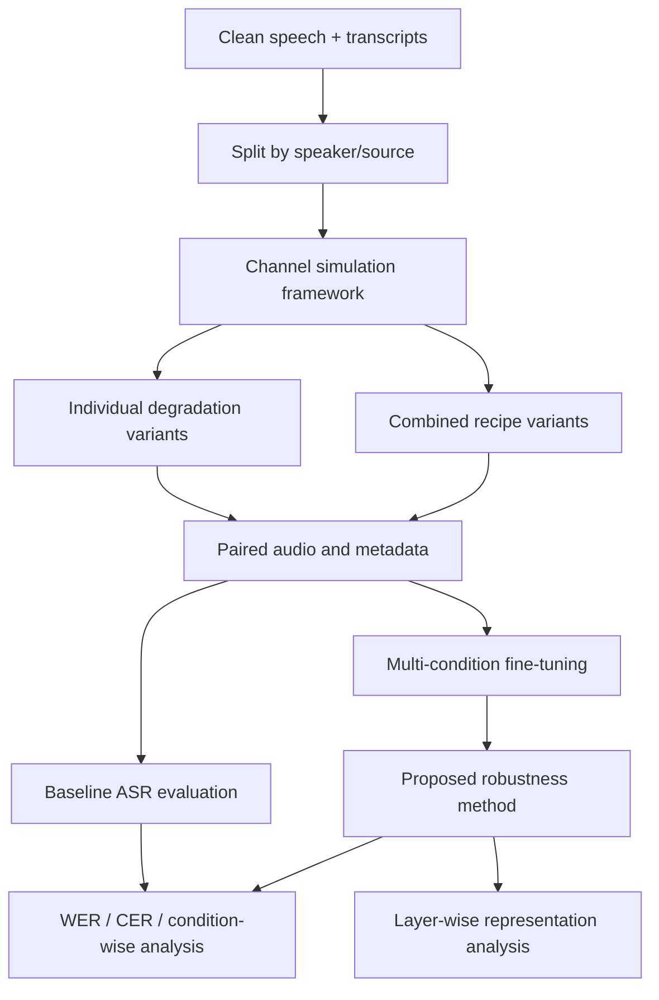

# Radio Channel Degradations and ASR Robustness

Research notes for understanding the channel models in the **Radio Channel Simulation for ASR Robustness Evaluation** project and using them to study robust Automatic Speech Recognition (ASR).

> **Scope note:** This document explains the six impairment types and five example degradation recipes described in the project README and discussion. Parameter values labelled *example* are experimental/demo settings, not universal defaults. The exact defaults and whether a parameter is exposed to users must be checked against the corresponding Python function signature and implementation.

---

## Table of Contents

1. [Project Objective](#1-project-objective)
2. [Speech Transmission and Channel Degradation](#2-speech-transmission-and-channel-degradation)
3. [Individual Channel Impairments](#3-individual-channel-impairments)
   - [Jakes Multipath Fading](#31-jakes-multipath-fading)
   - [Watterson HF Ionospheric Channel](#32-watterson-hf-ionospheric-channel)
   - [Additive White Gaussian Noise](#33-additive-white-gaussian-noise-awgn)
   - [Band-Limiting Filter](#34-band-limiting-filter)
   - [GSM Full-Rate Vocoder](#35-gsm-full-rate-vocoder)
   - [Burst Packet Loss](#36-burst-packet-loss)
4. [Combined Channel Degradation Recipes](#4-combined-channel-degradation-recipes)
5. [How Channel Degradations Affect ASR](#5-how-channel-degradations-affect-asr)
6. [Research Directions for Improving ASR Robustness](#6-research-directions-for-improving-asr-robustness)
7. [Proposed Experimental Framework](#7-proposed-experimental-framework)
8. [Evaluation Metrics](#8-evaluation-metrics)
9. [Implementation and Scientific-Validity Checklist](#9-implementation-and-scientific-validity-checklist)
10. [Suggested Research Roadmap](#10-suggested-research-roadmap)
11. [References](#11-references)

---

## 1. Project Objective

The project simulates communication-channel impairments on clean speech recordings. Its main purpose is to create controlled, repeatable audio conditions for testing how ASR systems behave when speech is transmitted over imperfect radio or network channels.

The project is useful for two related tasks:

1. **Robustness evaluation:** Measure how much an ASR system's recognition performance changes when clean speech is degraded.
2. **Robustness improvement:** Use simulated degraded speech to train or adapt an ASR system so that it performs better under channel conditions that differ from its original training data.

The simulator is therefore more than an audio-effects demonstration. It can provide a controlled experimental environment for studying acoustic distribution shift and robust speech representation learning.

### Main impairment categories

| Category | Implemented models | What changes in the signal? |
|---|---|---|
| Propagation impairments | Jakes fading, Watterson HF | Signal amplitude, phase, delay and/or time variation |
| Additive noise | AWGN | Random noise energy is added to speech |
| Spectral distortion | Band limiting | Part of the speech frequency spectrum is removed |
| Codec distortion | GSM Full-Rate | Speech is encoded and reconstructed using lossy compression |
| Network impairment | Burst packet loss | Some time segments are lost and may be concealed or replaced |

**Terminology:** These are not all technically “noise” models. AWGN is an additive-noise model; fading and Watterson are propagation-channel models; band limiting is filtering; GSM introduces codec distortion; and packet loss is a network impairment. The broader term **channel degradation** or **channel impairment** is more accurate for the complete toolkit.

---

## 2. Speech Transmission and Channel Degradation

### 2.1 Ideal communication

Let `x(t)` be the clean speech signal transmitted by a speaker. In an ideal system, the received signal would be identical to the transmitted signal:

\[
y(t) = x(t)
\]

Real channels alter the signal before it reaches the receiver.

### 2.2 A simplified channel model

A common model for a linear propagation channel with additive noise is:

\[
y(t) = h(t) * x(t) + n(t)
\]

where:

- `x(t)` is the transmitted clean speech.
- `h(t)` represents the channel response.
- `*` denotes convolution.
- `n(t)` is additive noise.
- `y(t)` is the received speech.

This equation is a useful starting point, but it does not describe every impairment in the repository. Codec processing is nonlinear and lossy, while packet loss removes discrete time segments. A more general processing chain can be written as:

\[
y = T_K(T_{K-1}(\ldots T_2(T_1(x))\ldots))
\]

where each `T_i` is one degradation operation, such as fading, filtering, codec encoding/decoding or packet loss.

### 2.3 Why the same clean sample is important

For a controlled comparison, every individual degradation should start from the same clean source recording. The recipe comparisons should also use that same source.

For example:

```text
Clean speech ──┬── AWGN ───────────────> AWGN sample
               ├── Jakes fading ──────> Fading sample
               ├── GSM encode/decode ─> GSM sample
               └── Packet loss ───────> Packet-loss sample
```

This makes the channel condition the main variable being changed. If different source recordings are used, differences in speaker, phonetic content, duration or recording quality can confound the comparison.

### 2.4 Signal properties to keep track of

For every source and generated sample, record at least:

- Sampling rate.
- Number of channels (mono/stereo).
- Duration and number of samples.
- Peak amplitude and RMS level.
- Degradation type and parameter values.
- Random seed for stochastic degradation, where applicable.
- Source recording ID and transcript.

The project commonly uses 16 kHz mono audio for ASR-oriented examples. GSM Full-Rate, however, operates at an 8 kHz sampling rate, so its input/output resampling must be handled explicitly.

---

## 3. Individual Channel Impairments

## 3.1 Jakes Multipath Fading

**Category:** Mobile-radio propagation impairment  
**Project function:** `apply_jakes_fading` in `analog.py`  
**Typical scenario:** A mobile VHF/UHF receiver, such as a radio inside a moving patrol vehicle.

### What is multipath fading?

A transmitted radio signal may reach the receiver through multiple propagation paths. Some energy may travel directly, while other components may be reflected, scattered or diffracted by buildings, vehicles and other objects.

The receiver therefore receives multiple versions of the transmitted signal. These components can have different phases and amplitudes. When they combine, they may reinforce one another or partially cancel one another. The received signal amplitude can consequently fluctuate over time. This phenomenon is called **multipath fading**.

The classical Jakes model is a sum-of-sinusoids approximation associated with mobile-radio fading. It models time-varying fading caused by motion and Doppler effects. The underlying mobile-radio scattering model is discussed in Clarke's statistical theory of mobile-radio reception [1].

### Doppler frequency

A receiver moving relative to the transmitter experiences Doppler shifts. The maximum Doppler frequency is commonly expressed as:

\[
f_{D,\max} = \frac{v}{c} f_c
\]

where:

- `v` is receiver speed in metres per second.
- `c` is the speed of light (approximately `3 × 10^8 m/s`).
- `f_c` is carrier frequency in hertz.

For a carrier frequency of 150 MHz and a speed of 40 km/h:

\[
v = 40 / 3.6 \approx 11.11\;\text{m/s}
\]

\[
f_{D,\max} \approx \frac{11.11}{3\times10^8}\times150\times10^6
\approx 5.56\;\text{Hz}
\]

This is the maximum Doppler magnitude under the stated approximation. Individual arriving paths can have different Doppler shifts depending on their arrival angles.

### Parameters

| Parameter | Meaning | Expected influence |
|---|---|---|
| `f_c` | Carrier frequency | Higher carrier frequency increases maximum Doppler shift at a fixed speed |
| `velocity_kmh` | Receiver speed | Higher speed causes faster channel variation |
| `num_paths` | Number of sinusoidal components used by the approximation | Affects the numerical approximation of the fading process |

The project documentation gives 150 MHz and 40 km/h as an example configuration and describes 20 paths as the default in the function documentation. Confirm the actual defaults in `analog.py` before reporting them as implementation defaults.

### How it changes speech

If the implementation applies a time-varying gain to the speech waveform, different regions of the recording may become louder or quieter. A deep fade can attenuate a low-energy consonant or part of a syllable. The result may sound as though the voice volume is fluctuating or briefly dropping.

Possible audible effects:

- Fluctuating loudness.
- Short periods of attenuation.
- Reduced audibility of weak speech components.
- Unstable speech level over time.

### ASR implications

The acoustic evidence for a phoneme may become weaker during a fade. A recognizer can then confuse similar-sounding words, omit weak consonants or fail to identify a short speech segment.

### Important modelling distinction

A time-varying scalar gain models **flat fading**. A frequency-selective multipath channel requires delayed paths or a channel impulse response with multiple taps. Do not describe an implementation as frequency-selective merely because it is named “multipath”; inspect whether the code actually models path delays and combines delayed copies.

---

## 3.2 Watterson HF Ionospheric Channel

**Category:** HF radio propagation impairment  
**Project function:** `apply_watterson_hf` in `analog.py`  
**Typical scenario:** Long-distance HF communication, including aviation, maritime and remote operations.

### What is HF propagation?

HF means **High Frequency**, covering approximately 3–30 MHz. HF radio can support beyond-line-of-sight communication because radio waves can propagate through the ionosphere and return toward the Earth's surface.

The ionosphere is not a static channel. A transmitted signal can arrive through multiple propagation modes, with each path having a different delay and Doppler shift. The received signal is therefore a combination of time-shifted and time-varying components.

ITU-R Recommendation F.1487 describes methods for testing HF systems using ionospheric channel simulators. It discusses multipath propagation, fading and Doppler effects [2].

### Main channel effects

**Multipath delay:** Different propagation paths take different amounts of time to reach the receiver. Delayed copies overlap with later parts of the speech signal.

**Doppler shift/spread:** Motion or time variation in the propagation medium changes the frequency of arriving components. Different paths can experience different Doppler shifts.

**Fading:** The components combine, causing the received amplitude to vary over time.

A simplified tapped-delay representation is:

\[
y[n] = \sum_{l=1}^{L} h_l[n]x[n-d_l] + n[n]
\]

where:

- `L` is the number of channel taps or paths.
- `h_l[n]` is the time-varying response of path `l`.
- `d_l` is the path delay in samples.
- `n[n]` is additive noise, if included.

This equation illustrates the type of channel structure; the exact number of taps, fading processes and implementation details depend on the code.

### Project example profiles

| Profile | Delay setting | Doppler-spread setting | General interpretation |
|---|---:|---:|---|
| Quiet | 0.5 ms | 0.1 Hz | Relatively stable example channel |
| Moderate | 1.0 ms | 0.5 Hz | More time variation and delay |
| Disturbed | 2.0 ms | 1.0 Hz | More severe example channel |

These are the example profile values documented for this project. They should not be presented as universal values for every real HF link.

### How it changes speech

The combination of delayed components and time-varying fading can smear or alter parts of the waveform. Depending on the delay and channel configuration, the result can sound unstable, distorted or less clear.

Possible audible effects:

- Fluctuating loudness.
- Overlap between delayed signal components.
- Distortion of speech transitions.
- Reduced clarity of short phonetic events.

### ASR implications

The channel can alter both temporal and spectral evidence used by the ASR encoder. This makes Watterson HF useful for testing whether an ASR model is robust to more complex propagation effects than simple additive noise.

---

## 3.3 Additive White Gaussian Noise (AWGN)

**Category:** Additive-noise impairment  
**Project function:** `add_awgn` in `analog.py`  
**Typical scenario:** Receiver thermal noise or broadband background interference approximated as Gaussian noise.

### What is AWGN?

AWGN is a standard mathematical noise model:

- **Additive:** Noise is added to the original signal.
- **White:** Its power spectral density is constant over the modelled frequency range.
- **Gaussian:** Its amplitude follows a Gaussian (normal) probability distribution.

The discrete-time model is:

\[
y[n] = x[n] + n[n]
\]

where `x[n]` is clean speech and `n[n]` is a zero-mean Gaussian noise sequence.

### Signal-to-Noise Ratio (SNR)

The main parameter is Signal-to-Noise Ratio (SNR), expressed in decibels:

\[
SNR_{dB} = 10\log_{10}\left(\frac{P_{signal}}{P_{noise}}\right)
\]

For a desired SNR, the noise power can be set from the signal power:

\[
P_{noise} = \frac{P_{signal}}{10^{SNR_{dB}/10}}
\]

If the implementation uses zero-mean Gaussian noise, its variance is selected to achieve the target noise power.

### Example SNR conditions

| SNR | General listening expectation |
|---:|---|
| 20 dB | Relatively clear; noise is usually less prominent |
| 15 dB | Noticeable background noise |
| 10 dB | Stronger noise; some speech details become harder to hear |
| 5 dB | Considerable masking of speech components |
| 0 dB | Signal and noise have equal average power |

These are illustrative listening descriptions, not fixed intelligibility thresholds. Actual intelligibility depends on the speaker, utterance, spectrum, noise realization and playback conditions.

### Example

Suppose the clean speech has an average power of `0.01` in the units used by the implementation. For an SNR of 10 dB:

\[
P_{noise}=0.01/10^{10/10}=0.001
\]

The noise is generated with the required power and added to the clean waveform.

### How it changes speech

AWGN raises the noise floor across the signal's frequency range. Weak speech components can be masked by the noise, especially low-energy consonants and unvoiced sounds such as /s/ and /f/.

Possible audible effects:

- Continuous hiss or static-like background noise.
- Less distinct consonants.
- Reduced clarity as SNR decreases.
- More difficulty identifying quiet words and word boundaries.

### ASR implications

Noise can obscure acoustic features that help distinguish phonemes. A model trained primarily on clean audio may confuse similar phonetic patterns or omit words when the signal-to-noise ratio becomes low.

### Modifiable parameters

The principal experimental parameter is `snr_db` (or the equivalent argument used by the implementation). Vary it systematically, for example over 20, 15, 10, 5 and 0 dB. Record the target SNR and, when possible, measure the achieved SNR after generation to verify the implementation.

---

## 3.4 Band-Limiting Filter

**Category:** Spectral distortion  
**Project function:** `apply_band_limiting` in `digital.py`  
**Typical scenario:** Narrowband voice communication over handheld or constrained-bandwidth radio systems.

### What is band limiting?

A speech signal contains energy across a range of frequencies. A communication system may only transmit a restricted frequency band. A band-limiting filter removes or attenuates frequencies outside the retained band.

For a linear filter:

\[
Y(f)=X(f)H(f)
\]

where:

- `X(f)` is the original speech spectrum.
- `H(f)` is the filter's frequency response.
- `Y(f)` is the filtered speech spectrum.

For a low-pass filter, frequencies above the cutoff are attenuated. The exact transition band and attenuation depend on the filter design used in `digital.py`.

### Why does this matter for speech?

Different speech sounds have different spectral characteristics. Many unvoiced fricatives contain important high-frequency energy. Restricting bandwidth can therefore reduce cues used to distinguish sounds such as /s/, /f/, /sh/ and /th/.

### Example cutoff settings

| Cutoff frequency | Expected effect |
|---:|---|
| 4000 Hz | Retains more high-frequency detail |
| 3400 Hz | More restricted speech bandwidth |
| 2000 Hz | Strong loss of high-frequency information |
| 1000 Hz | Very narrow retained frequency range |

These are example experimental values discussed for the project. Confirm that the implementation uses a low-pass cutoff with the same interpretation before treating them as exact settings.

### How it changes speech

Possible audible effects:

- Speech sounds muffled or less crisp.
- High-frequency consonants become less distinct.
- Some phonetic contrasts become harder to hear.
- Severe restriction can make speech sound telephone-like or narrowband.

### ASR implications

A model trained on wideband speech may rely on high-frequency cues that are reduced or absent in narrowband input. This makes band limiting a useful controlled test of spectral robustness.

### Modifiable parameters

The key parameter is the filter cutoff frequency (and any other filter parameters exposed by the function, such as filter order). The exact arguments must be checked in `digital.py`. Do not add UI controls for parameters that the implementation does not actually expose.

---

## 3.5 GSM Full-Rate Vocoder

**Category:** Lossy speech-codec distortion  
**Project function:** `apply_gsm_codec` in `digital.py`  
**Typical scenario:** Speech transmitted through a legacy GSM Full-Rate speech codec.

### What is a speech codec?

A speech codec compresses speech for transmission or storage. Rather than transmitting every original sample directly, the encoder represents speech using a compact set of parameters. The decoder reconstructs an approximation of the original signal.

GSM Full-Rate uses **Regular Pulse Excitation with Long-Term Prediction (RPE-LTP)**. It is a lossy codec: the decoded signal is not identical to the input.

### GSM Full-Rate characteristics

The GSM Full-Rate specification describes:

- Sampling rate: 8 kHz.
- Frame duration: 20 ms.
- Input samples per frame: 160.
- Encoded bits per frame: 260.
- Nominal codec bitrate: 13 kbit/s.

The relationship is:

\[
\frac{260\;\text{bits}}{0.020\;\text{s}} = 13{,}000\;\text{bits/s}
\]

The codec details are specified in 3GPP TS 46.010 [3].

### Processing chain

```text
Original speech
      |
      v
GSM encoder (RPE-LTP)
      |
      v
Compressed bitstream
      |
      v
GSM decoder
      |
      v
Reconstructed speech
```

### How it changes speech

The encoder cannot preserve every detail of the original waveform. The decoded speech may contain compression artifacts and lose fine acoustic detail.

Possible audible effects:

- Metallic or robotic-sounding voice quality.
- Reduced naturalness.
- Changes to fine spectral detail.
- Distortion around speech transitions.
- Reduced fidelity compared with the original waveform.

The degree and character of the distortion depend on the codec implementation and input speech.

### ASR implications

An ASR model trained on clean wideband recordings may encounter different spectral and temporal characteristics after speech has been encoded and decoded. Codec robustness is therefore distinct from robustness to additive noise.

### Project environment and validation

The project's GSM path uses the `experiments` Conda environment and available codec support (for example, SoX/libgsm where applicable). The README notes that the codec path may depend on installed system libraries or backend availability.

For every GSM sample:

1. Confirm the encoder and decoder actually ran.
2. Confirm the output is not simply a copy of the input.
3. Record the codec backend and its version.
4. Check the decoded sampling rate.
5. Resample deliberately if the ASR pipeline expects 16 kHz.
6. Record any resampling method and filter settings.

Do not silently substitute the clean recording if GSM processing fails. Mark the sample as failed and record the error.

### Modifiable parameters

The 13 kbit/s rate and 8 kHz input rate are properties of the GSM Full-Rate mode, not arbitrary quality sliders in that mode. Other settings, such as backend selection, input/output resampling and codec invocation, may be configurable in the project. Inspect `apply_gsm_codec` before describing any of them as user-modifiable codec parameters.

---

## 3.6 Burst Packet Loss

**Category:** Network impairment  
**Project function:** `apply_burst_loss` in `network.py`  
**Typical scenario:** VoIP or real-time audio communication over an unstable or congested network.

### What is packet loss?

For network transmission, audio is divided into packets. The receiver reconstructs the audio stream from the packets that arrive. If packets are dropped or arrive too late to be useful, corresponding portions of the audio are missing.

At a packetization interval of 20 ms, a one-second recording contains approximately:

\[
1 / 0.020 = 50\;\text{packets}
\]

### Random loss versus burst loss

- **Random packet loss:** Individual packets are lost intermittently.
- **Burst packet loss:** Several consecutive packets are lost.

Burst loss is often particularly damaging because it can remove a continuous segment containing part of a phoneme, syllable or word.

### Gilbert-Elliott two-state model

The project uses a two-state Markov model:

- **Good state:** Packets are received.
- **Bad state:** Packets are lost.

The model transitions between the two states.

| Parameter | Meaning in the project description |
|---|---|
| `p_loss` | Probability of transitioning from Good to Bad |
| `p_recovery` | Probability of transitioning from Bad to Good |

If the Good-to-Bad transition probability is `p_loss` and the Bad-to-Good transition probability is `p_recovery`, then the stationary fraction of time in the Bad state is:

\[
P(B)=\frac{p_{loss}}{p_{loss}+p_{recovery}}
\]

The expected number of consecutive packets in the Bad state is:

\[
E[L_{bad}] = \frac{1}{p_{recovery}}
\]

For example, if `p_recovery = 0.5`, the expected bad-state burst length is 2 packets. This is an expectation, not a guarantee that every burst contains exactly two packets.

**Important:** `p_loss` as a Good-to-Bad transition probability is not the same as the long-run fraction of packets lost. The long-run loss ratio also depends on the recovery probability. This distinction is described in RFC 6534 [4].

### Packet Loss Concealment (PLC)

The project README describes a simple PLC strategy that repeats the last good packet with an attenuation factor of 0.8. This can reduce abrupt silence, but it may create repeated or unnatural audio segments.

PLC is a reconstruction strategy, not recovery of the original missing speech. The replacement is an estimate or substitute for the missing packet.

### How it changes speech

Possible audible effects:

- Gaps or dropouts.
- Repeated audio segments.
- Abrupt transitions.
- Missing parts of syllables or words.
- Broken temporal continuity.

For example:

```text
Original:       "Please call me tomorrow."
After packet loss: "Please ... me tomorrow."
```

The example illustrates the effect; the exact missing words depend on which packets are lost.

### ASR implications

Packet loss can remove phonetic information entirely rather than merely making it noisy. The recognizer must use the remaining acoustic evidence and linguistic context to infer what was spoken. This can cause deletions, substitutions or hallucinated words.

### Modifiable parameters

The project exposes or documents `p_loss` and `p_recovery`. Check `network.py` for any additional parameters such as packet/frame duration, concealment method, attenuation factor and random seed. Report the realised packet-loss ratio and burst-length statistics in addition to the transition probabilities.

---

## 4. Combined Channel Degradation Recipes

A real communication path may introduce more than one impairment. A **degradation recipe** applies multiple operations to the same speech recording in a defined order.

The processing order matters because channel operations are generally not interchangeable:

\[
T_2(T_1(x)) \neq T_1(T_2(x))
\]

For example, applying a codec before a filter can produce a different result from applying the filter before the codec.

The recipes below are illustrative scenarios defined by this project. They should not be interpreted as calibrated measurements of every real-world system represented by the scenario name.

### 4.1 VHF Mobile — Police Communication

**Processing chain:**

```text
Clean speech -> Jakes fading -> AWGN -> Final output
```

**Scenario:** A patrol vehicle communicates over a VHF radio while moving through an urban environment.

**What happens:**

1. Jakes fading introduces time-varying amplitude changes associated with mobile-radio propagation.
2. AWGN adds receiver noise to the faded signal.

**Expected audible result:** Speech loudness fluctuates and background hiss/static becomes audible. Weak speech components may be harder to distinguish.

**ASR challenge:** The model must handle both time-varying signal attenuation and additive noise.

### 4.2 HF Aviation — Long-Distance Communication

**Processing chain:**

```text
Clean speech -> Watterson HF (Moderate) -> AWGN -> Final output
```

**Scenario:** A pilot communicates with a distant air traffic control station over an HF link.

**What happens:**

1. The Watterson model introduces the configured HF multipath, delay and Doppler effects.
2. AWGN adds receiver noise.

**Expected audible result:** The speech may sound less stable and less clear due to propagation distortion and noise.

**ASR challenge:** The model must recognise speech when both temporal and spectral evidence are affected.

### 4.3 Digital Tactical Radio — Restricted Bandwidth and Codec

**Processing chain:**

```text
Clean speech -> Band limiting -> GSM codec -> AWGN -> Final output
```

**Scenario:** An illustrative narrowband digital voice link with bandwidth restriction, codec distortion and receiver noise.

**What happens:**

1. Band limiting removes or attenuates frequencies outside the configured passband.
2. GSM encoding and decoding introduce lossy codec distortion.
3. AWGN adds noise to the reconstructed speech.

**Expected audible result:** Speech loses high-frequency detail, may sound compressed or metallic, and contains additional noise.

**ASR challenge:** The model must handle spectral information loss, codec artifacts and additive noise together.

**Technical qualification:** GSM Full-Rate is a legacy cellular speech codec. This recipe is a controlled combination of impairments; it is not a claim that all tactical radio systems use GSM Full-Rate.

### 4.4 VoIP — Office or Remote Meeting

**Processing chain:**

```text
Clean speech -> Burst packet loss -> Final output
```

**Scenario:** A VoIP call experiences packet drops during network congestion or wireless interference.

**What happens:**

1. The Gilbert-Elliott model generates good and bad network states.
2. Packets associated with bad states are lost.
3. The configured PLC strategy attempts to conceal missing packets.

**Expected audible result:** Short gaps, repeated segments or broken words.

**ASR challenge:** The model must infer words from incomplete temporal evidence.

### 4.5 Extreme Arctic Operations — Severe Combined Channel

**Processing chain:**

```text
Clean speech
    -> Watterson HF (Disturbed)
    -> GSM codec
    -> Burst packet loss
    -> Final output
```

**Scenario:** An illustrative severe communication path combining disturbed HF propagation, codec distortion and network packet loss.

**What happens:**

1. Watterson HF introduces stronger example multipath and Doppler settings.
2. GSM encoding/decoding introduces compression artifacts.
3. Burst packet loss removes additional time segments and applies the configured PLC strategy.

**Expected audible result:** Multiple forms of degradation occur together: unstable propagation, reduced fidelity and missing or repeated audio segments.

**ASR challenge:** This tests whether the model can recognise speech when several information-loss mechanisms interact.

### Recipe comparison

| Recipe | Degradation sequence | Main challenge for ASR |
|---|---|---|
| VHF Mobile | Jakes -> AWGN | Fading + additive noise |
| HF Aviation | Watterson Moderate -> AWGN | Multipath + Doppler + noise |
| Digital Tactical | Band limit -> GSM -> AWGN | Spectral loss + codec + noise |
| VoIP | Burst packet loss | Missing temporal segments |
| Extreme Arctic | Watterson Disturbed -> GSM -> burst loss | Combined propagation, codec and packet impairments |

### Recipe reproducibility

For each generated recipe sample, save:

- Original clean sample ID.
- Ordered list of transformations.
- All parameters for every stage.
- Random seed for stochastic stages.
- Intermediate output paths, where practical.
- Final output path.
- Tool/library versions and any codec backend used.
- Validation results (sample rate, duration, finite values, non-silence and output/input difference).

---

## 5. How Channel Degradations Affect ASR

### 5.1 Typical ASR pipeline

A conventional end-to-end ASR system can be represented as:

```text
Audio waveform
      |
      v
Feature / latent representation extraction
      |
      v
Acoustic encoder
      |
      v
Prediction or decoding layer
      |
      v
Recognised text
```

Wav2Vec 2.0 is a self-supervised speech representation model that learns contextual speech representations and can be fine-tuned for recognition [5]. Whisper is a multilingual, multitask speech-recognition model trained using large-scale weak supervision [6]. Both provide useful comparison points, but their architectures and training data differ.

### 5.2 Acoustic feature corruption

ASR models rely on acoustic evidence to distinguish phones and words. Degradations can weaken or remove that evidence.

Examples:

- AWGN can mask low-energy consonants.
- Band limiting can remove high-frequency fricative cues.
- Fading can attenuate a word or phonetic segment.
- Watterson HF can introduce time-varying multipath distortion.
- GSM can alter fine acoustic detail through lossy encoding.
- Packet loss can remove an entire speech segment.

### 5.3 Distribution shift

Suppose a model is trained on clean speech samples drawn from a training distribution:

\[
P_{train}(x,y)
\]

where `x` is audio and `y` is its transcript. At inference time, the model may receive channel-degraded audio from a different distribution:

\[
P_{test}(x,y) \neq P_{train}(x,y)
\]

This mismatch is a form of distribution shift. A model that performs well on clean speech may perform poorly when its input acoustic conditions differ from those represented during training.

### 5.4 Temporal information loss

Some degradations change the signal but retain the complete time sequence. Other degradations remove sections entirely. Packet loss is an example of the latter.

When an entire phoneme or syllable is missing, the model cannot recover the original acoustic evidence. It must use the surrounding audio and linguistic context to infer the most likely words.

### 5.5 Why evaluate individual and combined conditions?

Individual conditions help identify which impairment causes a performance drop. Combined recipes test whether the model remains robust when several impairments occur in sequence.

Both are necessary:

- **Individual tests** support controlled attribution.
- **Combined tests** are closer to complex communication scenarios.

---

## 6. Research Directions for Improving ASR Robustness

The channel simulator provides a way to create controlled training and evaluation data. The research contribution should be the method used to improve ASR performance under those conditions.

### 6.1 Multi-Condition Training

**Idea:** Fine-tune an ASR model using a mixture of clean and channel-degraded versions of the training speech.

Each generated version retains the source transcript if the degradation has not changed the spoken linguistic content.

Example paired data:

| Source | Input condition | Transcript |
|---|---|---|
| `utt_001` | Clean | `Please call me tomorrow.` |
| `utt_001` | AWGN, 10 dB | `Please call me tomorrow.` |
| `utt_001` | Jakes fading | `Please call me tomorrow.` |
| `utt_001` | GSM encode/decode | `Please call me tomorrow.` |
| `utt_001` | Burst packet loss | `Please call me tomorrow.` |

The training objective is to recognise the same linguistic content across different acoustic conditions.

A simple training mixture could sample clean and degraded audio with a chosen probability. The exact mixture ratio should be an experimental variable rather than an arbitrary fixed assumption.

Multi-condition training is an established approach in robust ASR. Research such as patched multi-condition training explores additional ways of mixing clean and distorted speech segments [7].

**Potential benefit:** The model sees a wider range of acoustic conditions during training.

**Potential risk:** If the training mix contains too much severe degradation, clean-speech performance may decrease. Evaluate clean and degraded test sets separately.

### 6.2 Degradation-Aware Training

**Idea:** Track which channel condition produced each sample and deliberately balance training across degradation types and severities.

An example batch schedule:

| Batch/source condition | Example data |
|---|---|
| Clean/noise | Clean speech and AWGN variants |
| Mobile radio | Jakes fading variants and Jakes + AWGN |
| HF radio | Watterson profiles and Watterson + AWGN |
| Digital voice | Band-limited and GSM variants |
| Network | Burst packet-loss variants |
| Combined | The five recipe outputs |

This makes it possible to study whether balanced exposure is more effective than sampling all generated examples uniformly.

### 6.3 Curriculum Learning

**Idea:** Increase degradation difficulty over training rather than introducing the most severe conditions immediately.

An example curriculum:

1. **Mild stage:** Higher SNR, mild fading, relatively wide bandwidth and low packet-loss severity.
2. **Moderate stage:** Lower SNR, stronger fading, narrower bandwidth, codec distortion and moderate packet loss.
3. **Severe stage:** Low SNR and challenging combinations of propagation, codec and packet impairments.

This is a hypothesis to test, not a guaranteed improvement. Compare it with a baseline that uses the same overall degradation distribution in a random order.

### 6.4 Representation-Level Robustness

**Idea:** Study whether the model's internal speech representations preserve linguistic information when channel conditions change.

Let `x` be clean speech and `T(x)` be a degraded version. Pass both through the same encoder:

\[
z_c = Encoder(x)
\]

\[
z_d = Encoder(T(x))
\]

The aim is to retain information useful for recognising the same transcript while avoiding unnecessary sensitivity to channel changes.

A possible training objective is:

\[
\mathcal{L}_{total} = \mathcal{L}_{ASR} + \lambda\mathcal{L}_{consistency}
\]

For a CTC-based recogniser, one possible extension is:

\[
\begin{aligned}
\mathcal{L}_{total} ={}& \mathcal{L}_{CTC}(x,y) \\
&+ \alpha\mathcal{L}_{CTC}(T(x),y) \\
&+ \lambda D(z_c,z_d)
\end{aligned}
\]

where:

- `L_CTC` is the CTC recognition loss.
- `y` is the reference transcript.
- `D` is a representation distance or consistency objective.
- `alpha` and `lambda` control the contributions of the losses.

**Important design issue:** A degraded signal may have different frame-level alignment from its clean counterpart, especially after packet loss, resampling or time-varying channel effects. Directly forcing every clean frame to equal the same-index degraded frame can be inappropriate. Consider sequence-level, pooled, alignment-aware or teacher-student consistency methods and validate the alignment assumptions.

### 6.5 Layer-Wise Representation Analysis

Representations from different encoder layers may react differently to channel changes. Extract hidden representations for clean and degraded versions and compare them layer by layer.

Possible analysis questions:

- Which layers are most sensitive to AWGN?
- Does bandwidth limitation affect early layers more strongly than later layers?
- Do codec and packet-loss distortions change representations differently?
- Are combined impairments more disruptive than individual impairments?
- Do layers preserve similar representations even when WER changes?

PWCCA (Projection-Weighted Canonical Correlation Analysis) can be used as one measure of similarity between representation sets. It is a diagnostic measure, not by itself proof that two representations preserve the same linguistic information. Pair it with ASR metrics and phonetic/linguistic analyses.

### 6.6 Speech Enhancement Before ASR

A separate enhancement model can attempt to improve degraded audio before recognition:

```text
Degraded audio -> Speech enhancement -> ASR model -> Transcript
```

Research question: Does enhancement improve ASR performance, or can it remove useful speech cues and introduce artifacts?

Evaluate the enhancement-plus-ASR pipeline against direct ASR on degraded audio. Do not assume that a cleaner-sounding signal always produces a more accurate transcript.

### 6.7 Unseen-Channel Generalization

**Idea:** Train on some degradation types, severities or recipes and test on conditions not seen during training.

Example:

- Train on AWGN, Jakes and GSM individually.
- Test on Watterson + GSM or an unseen combination of AWGN and packet loss.

This tests whether the model has learned a general form of robustness or has merely memorised the training conditions.

### 6.8 Channel-Conditioned ASR

Estimate the channel type or severity and provide that information to the ASR model. The condition could be used to select an adapter, modulate intermediate representations or route the input through a specialised component.

Research question: Does explicit channel information improve recognition compared with generic multi-condition training?

---

## 7. Proposed Experimental Framework

### 7.1 Recommended initial research objective

A manageable starting objective is:

> **Investigate how realistic radio and network channel impairments affect pretrained ASR models, then evaluate whether multi-condition fine-tuning and layer-wise representation consistency improve robustness to individual and unseen combinations of degradations.**

A possible research title is:

**Degradation-Aware Speech Representation Learning for Robust Automatic Speech Recognition under Radio and Network Channel Impairments**

### 7.2 Experimental pipeline



### 7.3 Phase 1 — Establish baseline performance

Start with pretrained models before changing their parameters.

Suggested models:

- Wav2Vec 2.0 (for example, a pretrained base checkpoint fine-tuned or configured for the target language/task).
- Whisper (use the same audio test set and a fixed model/checkpoint for all comparisons).

Run inference on:

1. Clean audio.
2. Each of the six individual impairment types.
3. Each of the five combined recipes.

Record WER, CER, model configuration, decoding parameters and exact audio-file IDs.

**Purpose:** Identify which conditions cause the largest recognition degradation and establish a reproducible baseline.

### 7.4 Phase 2 — Build the paired training dataset

Generate degraded variants from the training split only. Keep the transcript linked to the original utterance.

Suggested metadata fields:

| Field | Example |
|---|---|
| `utterance_id` | `utt_001` |
| `speaker_id` | `speaker_01` |
| `source_path` | `clean/utt_001.wav` |
| `degradation_type` | `awgn` |
| `recipe_name` | `null` for an individual impairment |
| `parameters` | `{"snr_db": 10}` |
| `random_seed` | `2026` |
| `transcript` | `Please call me tomorrow.` |
| `output_path` | `degraded/utt_001_awgn_10db.wav` |
| `sample_rate` | `16000` |
| `duration_seconds` | `5.0` |

Use randomized parameter sampling over pre-defined valid ranges where appropriate. For example:

\[
SNR \sim U(0,20)\;\text{dB}
\]

This means sample an SNR value from a uniform range between 0 and 20 dB. The actual range and distribution should be selected based on the research question and verified against the implementation.

For stochastic impairments, consider generating multiple independent random realizations for the same source utterance and parameter setting.

### 7.5 Phase 3 — Fine-tune and compare models

A useful initial experiment matrix is:

| Experiment | Model training data | Purpose |
|---|---|---|
| E0 | Pretrained model, no task-specific fine-tuning | Zero-shot/frozen baseline where applicable |
| E1 | Clean speech only | Clean-data fine-tuning baseline |
| E2 | Clean + individual degradations | Multi-condition training baseline |
| E3 | Clean + individual + recipe variants | Effect of combined-condition training |
| E4 | Multi-condition training + representation consistency | Proposed method |

Keep model architecture, optimiser, training budget and evaluation set as consistent as possible. Whisper may initially be used as an inference-only comparison model; fine-tuning can be explored separately if resources and tooling permit.

### 7.6 Phase 4 — Test generalisation

Do not test only on the same fixed settings used to generate training data.

Use several evaluation partitions:

- **Clean test:** Measures preservation of ordinary recognition performance.
- **Seen-condition test:** Uses degradation types and ranges represented during training, but different utterances and random seeds.
- **Unseen-severity test:** Uses severities outside the training range.
- **Unseen-combination test:** Uses combinations or operation sequences not used during training.

For a fair comparison, every model should be evaluated on exactly the same test files and condition settings.

### 7.7 Data leakage prevention

Split the original clean dataset by speaker or recording source **before** generating any degraded variants.

Do not allow a clean utterance to appear in training while one of its degraded copies appears in validation or test. That would leak utterance content across splits and make the evaluation overly optimistic.

Keep all variants of an utterance in the same split. If multiple speakers or sessions exist, speaker-disjoint or session-disjoint splits are preferable when appropriate for the target deployment scenario.

---

## 8. Evaluation Metrics

### 8.1 Word Error Rate (WER)

WER measures word-level insertions, deletions and substitutions:

\[
WER = \frac{S+D+I}{N}
\]

where:

- `S` = number of substituted words.
- `D` = number of deleted words.
- `I` = number of inserted words.
- `N` = number of words in the reference transcript.

Example:

```text
Reference:  please call me tomorrow
Hypothesis: please tell me tomorrow
```

There is one substitution (`call` -> `tell`), no deletion and no insertion. There are four reference words:

\[
WER = \frac{1+0+0}{4} = 0.25 = 25\%
\]

WER can exceed 100% when many insertions occur. Define text normalisation consistently before scoring (for example, casing, punctuation, number formatting and tokenisation).

### 8.2 Character Error Rate (CER)

CER measures edit distance at the character level:

\[
CER = \frac{S_c+D_c+I_c}{N_c}
\]

where the counts are computed over characters rather than words. CER is useful for languages or tasks where character-level errors are informative.

### 8.3 Relative WER degradation

To quantify the increase in WER under a degraded condition relative to clean audio:

\[
\Delta WER_{rel} = \frac{WER_{degraded}-WER_{clean}}{WER_{clean}}\times100\%
\]

For example, if clean WER is 10% and degraded WER is 20%:

\[
\Delta WER_{rel} = \frac{0.20-0.10}{0.10}\times100 = 100\%
\]

The relative WER has increased by 100%. If clean WER is zero, this relative measure is undefined; report the absolute WER difference instead.

### 8.4 Additional reporting

Report:

- Clean WER and CER.
- WER and CER for each individual impairment.
- WER and CER for each combined recipe.
- Performance by severity/parameter value.
- Worst-condition performance.
- Average performance across conditions (state whether macro-averaged by condition or pooled over words).
- Clean-performance retention after fine-tuning.
- Confidence intervals or repeated-run variability where practical.

A useful results table is:

| Model | Clean WER | AWGN WER | GSM WER | Packet-loss WER | Unseen-recipe WER |
|---|---:|---:|---:|---:|---:|
| Baseline Wav2Vec 2.0 | — | — | — | — | — |
| Clean fine-tuned | — | — | — | — | — |
| Multi-condition fine-tuned | — | — | — | — | — |
| Proposed method | — | — | — | — | — |

Replace the dashes with measured results. Do not use illustrative numbers as experimental findings.

---

## 9. Implementation and Scientific-Validity Checklist

Before using generated audio in a paper or experiment, validate the following points.

### 9.1 Jakes fading

- Confirm whether the implementation applies flat, time-varying gain or includes delayed multipath taps.
- Record carrier frequency, velocity, number of paths and random seed.
- Confirm the Doppler calculation uses consistent units.
- Inspect the fading envelope and verify that the output is finite and non-silent.

### 9.2 Watterson HF

- Compare the implemented channel structure and parameter interpretation with the intended HF model.
- Record profile, path delays, Doppler settings and random seed.
- Label project-specific Quiet/Moderate/Disturbed presets as example profiles unless independently validated against a target channel specification.
- Do not claim that a simulated sample is a field recording.

### 9.3 AWGN

- Verify the achieved SNR after generation.
- Document whether SNR is computed over the full waveform or only active speech regions.
- Record the random seed.
- Avoid clipping when adding noise; document any normalisation or limiting.

### 9.4 Band limiting

- Record filter type, order, cutoff frequency and sample rate.
- Verify the frequency response and stopband attenuation.
- Remember that the Nyquist frequency is half the sampling rate. At 16 kHz sampling, the Nyquist frequency is 8 kHz.
- Distinguish a single low-pass cutoff from a true band-pass frequency range.

### 9.5 GSM codec

- Confirm that actual GSM encoding and decoding occur.
- Verify the codec backend and dependencies.
- Record input/output sample rates and resampling method.
- Check that the decoded result differs from the source.
- Never mark a skipped or failed codec operation as successful degradation.

### 9.6 Burst packet loss

- Distinguish state-transition probabilities from realised packet-loss percentage.
- Report the observed long-run loss ratio and burst-length distribution.
- Record packet duration, frame padding/trimming and PLC settings.
- Verify that padding to whole packets and trimming after simulation do not introduce unintended duration or alignment errors.

### 9.7 Combined recipes

- Apply operations in the documented order.
- Keep intermediate outputs during validation, at least for a small test set.
- Record all stage parameters and random seeds.
- Confirm each stage actually changes the signal as expected.
- Do not assume the order of two operations is interchangeable.

### 9.8 General audio checks

For every generated WAV file, validate:

- File opens successfully.
- Expected sample rate and channel count.
- Expected duration (allowing documented frame padding where required).
- Samples contain no NaN or infinity values.
- Signal is not unexpectedly silent.
- Peak amplitude is within a valid range and clipping is understood.
- The output is different from the source when a degradation is expected.
- The transcript still corresponds to the spoken content, or any cases where intelligibility is destroyed are labelled accordingly.

---

## 10. Suggested Research Roadmap

A practical order of work is:

| Stage | Work | Deliverable |
|---|---|---|
| 1 | Validate each simulator and parameter range | Verified channel simulation framework |
| 2 | Run pretrained Wav2Vec 2.0 and Whisper baselines | Condition-wise baseline table |
| 3 | Generate paired clean/degraded training data | Reproducible dataset and metadata manifest |
| 4 | Fine-tune on clean speech and multi-condition speech | Training baselines |
| 5 | Add representation-level consistency or another proposed method | Proposed robust ASR model |
| 6 | Evaluate unseen severities and combinations | Generalisation results |
| 7 | Analyse layer-wise representations with PWCCA and other diagnostics | Representation analysis |

### Recommended first research question

> Can multi-condition training, combined with layer-wise representation consistency, improve Wav2Vec 2.0 recognition under radio and network channel degradations while preserving clean-speech performance and generalising to unseen degradation combinations?

This question connects three parts of the project:

1. **Channel simulation:** Generates controlled, reproducible speech impairments.
2. **Robust ASR training:** Teaches the model to recognise speech across different channel conditions.
3. **Representation analysis:** Helps explain which layers change under degradation and whether the proposed training method makes them more robust.

Start with the baseline evaluation and simulator validation before implementing the new loss. This establishes which impairments matter most and prevents a training method from being designed around unverified simulations.

---

## 11. References

1. **Clarke, R. H. (1968).** “A Statistical Theory of Mobile-Radio Reception.” *The Bell System Technical Journal*, 47(6), 957–1000. [DOI / publisher page](https://doi.org/10.1002/j.1538-7305.1968.tb00069.x). Also available as a [PDF copy](https://courses.grainger.illinois.edu/ece458/Clarke68.pdf).
2. **ITU-R Recommendation F.1487 (2000).** “Testing of HF modems with bandwidths of up to about 12 kHz using ionospheric channel simulators.” [ITU recommendation page](https://www.itu.int/rec/R-REC-F.1487/en) · [PDF](https://www.itu.int/dms_pubrec/itu-r/rec/f/R-REC-F.1487-0-200005-I%21%21PDF-E.pdf).
3. **3GPP TS 46.010 / ETSI TS 146 010.** “Full rate speech; Transcoding.” Specifies the GSM Full-Rate RPE-LTP transcoding process. [3GPP specification record](https://portal.3gpp.org/desktopmodules/Specifications/SpecificationDetails.aspx?specificationId=284) · [ETSI TS 146 010 PDF](https://www.etsi.org/deliver/etsi_ts/146000_146099/146010/12.00.00_60/ts_146010v120000p.pdf).
4. **RFC 6534.** “Loss Episode Metrics for IP Performance Metrics (IPPM).” Includes discussion of the Gilbert-Elliott model, state transition probabilities and loss episodes. [RFC Editor](https://www.rfc-editor.org/rfc/rfc6534).
5. **Baevski, A., Zhou, Y., Mohamed, A., & Auli, M. (2020).** “wav2vec 2.0: A Framework for Self-Supervised Learning of Speech Representations.” *NeurIPS 2020*. [Paper](https://arxiv.org/abs/2006.11477) · [NeurIPS proceedings](https://papers.neurips.cc/paper/2020/hash/92d1e1eb1cd6f9fba3227870bb6d7f07-Abstract.html).
6. **Radford, A. et al. (2023).** “Robust Speech Recognition via Large-Scale Weak Supervision.” *Proceedings of ICML 2023*, PMLR 202, 28492–28518. [Paper](https://proceedings.mlr.press/v202/radford23a.html).
7. **Peso Parada, P., Dobrowolska, A., Saravanan, K., & Ozay, M. (2022).** “pMCT: Patched Multi-Condition Training for Robust Speech Recognition.” *Interspeech 2022*, 3779–3783. [ISCA Archive](https://www.isca-archive.org/interspeech_2022/pesoparada22_interspeech.html) · [DOI](https://doi.org/10.21437/Interspeech.2022-117).
8. **Kalinli, O., Seltzer, M., Droppo, J., & Acero, A. (2010).** “Noise Adaptive Training for Robust Automatic Speech Recognition.” *IEEE Transactions on Audio, Speech, and Language Processing*. [Microsoft Research publication page](https://www.microsoft.com/en-us/research/publication/noise-adaptive-training-robust-automatic-speech-recognition/).

---

## Final Note

The simulator creates controlled channel conditions; the ASR experiments determine how recognition performance changes; and the proposed learning method should explain and improve that performance. Keep those three roles separate in the experimental design. A reliable simulator, a leakage-free evaluation set and reproducible metadata are prerequisites for a credible robustness result.
